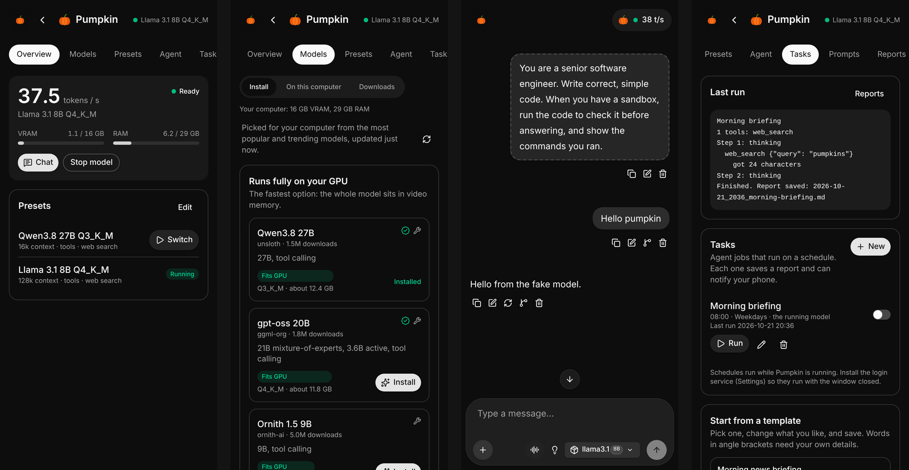
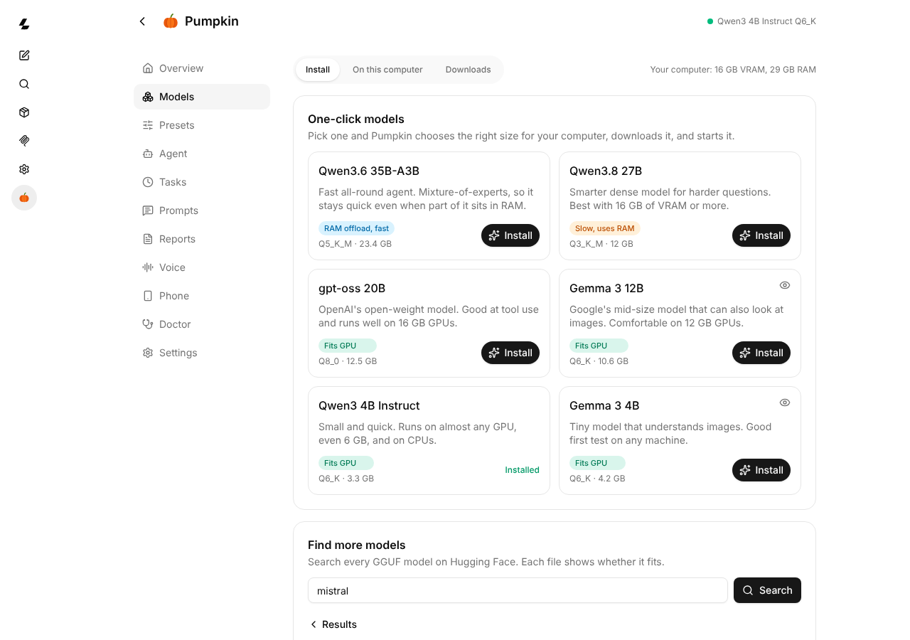

<p align="center"></p>

<h1 align="center">Pumpkin</h1>

<p align="center">Run AI models and agents on your own computer, and use them from your phone.<br>
Free, open source, and nothing leaves your machine unless you want it to.</p>

<p align="center"></p>

Pumpkin is a friendly home for [llama.cpp](https://github.com/ggml-org/llama.cpp). It looks at your
hardware, downloads the right llama.cpp build, picks a model size that fits your GPU, and gives you a
chat with tools, web search, scheduled agent tasks, voice and phone access, all from one interface.

## What it does

- **One-click models.** Pick a model and Pumpkin chooses the best quant for your GPU and RAM, downloads it,
  makes a preset and starts it. Every other GGUF on Hugging Face is a search away, each file marked
  *fits your GPU*, *runs with RAM offload* or *too big*.
- **Agents with tools.** Models can search the web and read pages (built in, no API key), run
  commands in a Docker sandbox, and use any MCP server you add.
- **Tasks on a schedule.** "Every weekday at 8:00, brief me on the news." Each run saves a Markdown
  report and can push a notification to your phone.
- **Phone access.** Scan a QR code and the whole app, chat included, works on your phone over
  Tailscale or your home Wi-Fi. Add it to your home screen and it behaves like an app.
- **Voice chat.** Talk hands-free and hear replies sentence by sentence as they stream.
- **Presets.** Each preset is a model plus how to run it: context size, KV cache type, thinking budget,
  tools, unload when idle. A live estimate shows whether it fits before you start it.
- **It explains problems.** When a model fails to start you get "the model did not fit in memory, try a
  smaller quant or a shorter context" instead of a log dump. The Doctor page checks the GPU driver,
  Vulkan, Docker permissions, disk space and Tailscale, and gives the command that fixes each one.
- **It stays out of the way.** Your computer won't suspend while a model is loaded (the screen still locks),
  and models can unload themselves when idle to free the GPU.

The chat is the llama.cpp web UI you may already know, with Pumpkin's pages added on top.

<p align="center"></p>

## Install

Pumpkin 0.1 runs on Linux (tested on Ubuntu 24.04 and newer) with an AMD, NVIDIA or Intel GPU, or on the
CPU alone. You need Python 3.10 or newer, which most distributions already have.

```sh
curl -fsSL https://raw.githubusercontent.com/geobellingham/pumpkin/main/install.sh | bash
```

Then open **Pumpkin** from your app menu, or run `pumpkin`. The first start walks you through:

1. **Your computer.** Pumpkin shows what it found: GPU, video memory, RAM.
2. **Model server.** It downloads the official llama.cpp build for your GPU (Vulkan for AMD and Intel,
   CUDA or Vulkan for NVIDIA), or uses the one you already have.
3. **First model.** Pick one and it installs and starts.

Optional extras:

| For | Install |
|---|---|
| Pumpkin's own window instead of a browser tab | `sudo apt install python3-gi gir1.2-webkit2-4.1` |
| The agent sandbox (running commands, editing files) | `sudo apt install docker.io && sudo usermod -aG docker $USER`, then log out and in |
| Phone access from anywhere | [Tailscale](https://tailscale.com/download) on the computer and the phone |
| Running at login, so schedules work with the window closed | Settings > *Start Pumpkin when I log in*, or `pumpkin service install` |

To remove it, run `~/.local/share/pumpkin/app/uninstall.sh`. Your models and reports stay in `~/Pumpkin`.

## Using it from your phone

Open **Phone** in Pumpkin and choose:

- **Tailscale:** works anywhere and is encrypted. Install Tailscale on both devices and sign in. The first
  time, Tailscale may ask you to run `sudo tailscale set --operator=$USER` and to turn on HTTPS
  certificates in its admin page; Pumpkin tells you if so.
- **Home network:** any device on your Wi-Fi can open it with the key. The traffic is not encrypted,
  so only use this on a network you trust.

Scan the QR code. It signs your phone in, and *Share > Add to Home Screen* gives you an app icon.
For task notifications, install the free [ntfy](https://ntfy.sh) app and paste your topic under
*Phone notifications*.

## Commands

```text
pumpkin                     open Pumpkin (starts it in the background if needed)
pumpkin link                print the sign-in links for this computer and your phone
pumpkin doctor              check the setup from a terminal
pumpkin service install     start Pumpkin when you log in
pumpkin stop                stop Pumpkin and the model
```

## How it works

```text
 phone / browser / app window
            │  https (Tailscale) or http
            ▼
 Pumpkin server  :8090  ── /pumpkin/api ── models, presets, tasks, reports, doctor
   (Python, no dependencies)
            │  everything else is passed through
            ▼
 llama-server  127.0.0.1:8080  ── --agent tools ── Docker sandbox, MCP servers, web search
```

- Settings live in `~/.config/pumpkin`, models and reports in `~/Pumpkin`, and llama.cpp builds in
  `~/.local/share/pumpkin`.
- Everything is behind a private key, stored in `~/.config/pumpkin/token`. The server only listens on
  127.0.0.1 unless you turn on home-network access.
- Pumpkin pins the llama.cpp release its UI is built from and downloads the same release of
  llama-server, so the two always match. You can point it at your own build in Settings.

## Coming from "LLM Studio"

If you used the earlier LLM Studio script, Pumpkin imports its presets, personas, tasks, prompts,
MCP config, reports folder and speed history on first start, and finds models in `/data/models`.

## Roadmap

- More natural voices generated on your computer (Kokoro, Orpheus)
- "Look at my screen" for vision models
- Quality benchmarks in the app
- macOS and Windows

## Contributing

Pull requests are welcome, especially new one-click models (`pumpkin/catalog.json`), hardware fit
estimates and Doctor checks. See [CONTRIBUTING.md](CONTRIBUTING.md).

## License

MIT. The web interface builds on the llama.cpp UI (MIT, the ggml authors).
