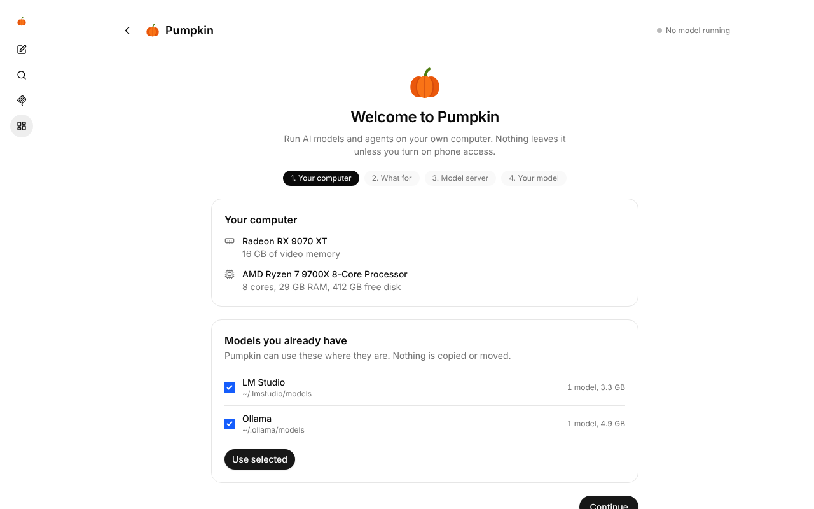
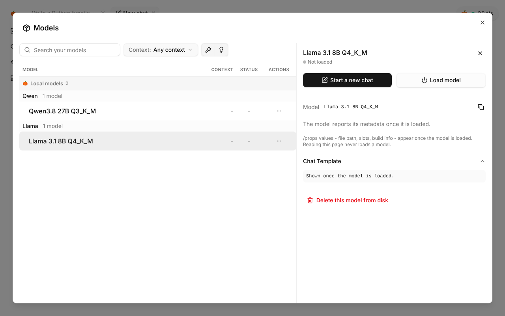
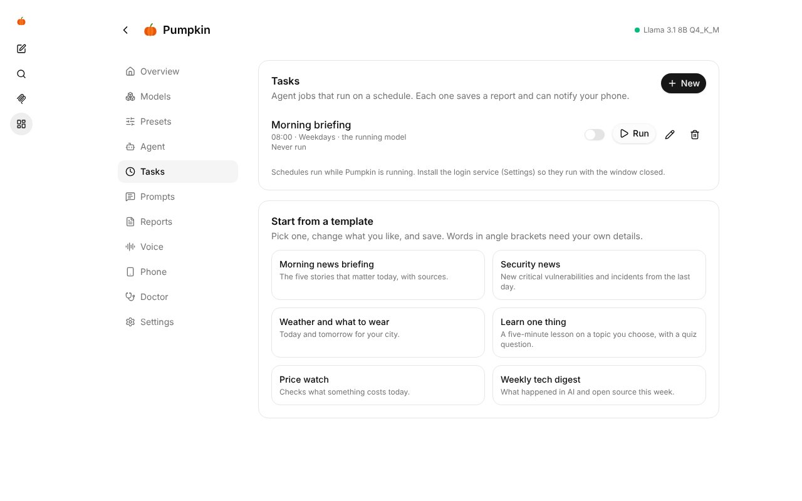
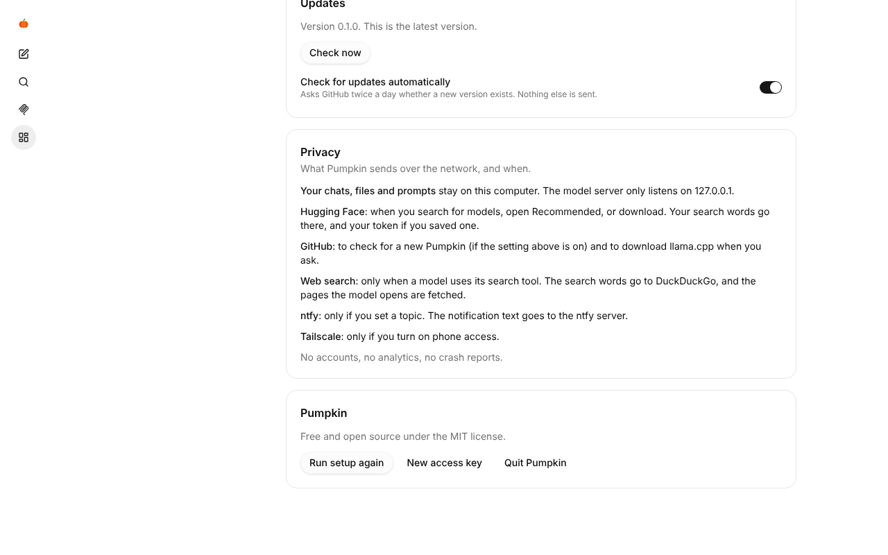

<p align="center"></p>

<h1 align="center">Pumpkin</h1>

<p align="center">Run AI models and agents on your own computer, and use them from your phone.<br>
Free, open source, and nothing leaves your machine unless you want it to.</p>

<p align="center"><br><sub><a href="docs/demo.mp4">Watch it as a video</a></sub></p>

<p align="center"></p>

Pumpkin is a friendly home for [llama.cpp](https://github.com/ggml-org/llama.cpp). It looks at your
hardware, downloads the right llama.cpp build, picks a model size that fits your GPU, and gives you a
chat with tools, web search, scheduled agent tasks, voice and phone access, all from one interface.

## What it does

- **One-click models.** Pick a model and Pumpkin chooses the best quant for your GPU and RAM, downloads it,
  makes a preset and starts it. Picks favour the most downloaded models from the uploaders most people trust
  (unsloth, ggml-org, bartowski and the model makers). A computer without a graphics card still gets models
  that run on the processor, marked *works, slowly*. Every other GGUF on Hugging Face is a search away, each
  file marked *fits your GPU*, *runs with RAM offload* or *too big*.
- **Answers from your documents.** Put PDFs, Word files, slides, spreadsheets, notes and emails in
  `~/Pumpkin/files` (or add your own folders) and ask about them. The model finds the right passages and
  says where each fact came from, like *(lease.pdf, p. 4)*, so even a small model answers from your papers
  instead of guessing. Everything is read on your computer.
- **It makes real files.** Ask for a report, letter, summary or table and the model saves it as a Word
  document, web page, Markdown or CSV file you can open and send. No Docker needed.
- **It draws.** Ask the chat for a picture and it appears in the conversation, saved in your Files. Pumpkin
  runs [stable-diffusion.cpp](https://github.com/leejet/stable-diffusion.cpp) with Z-Image Turbo (or a tiny
  model for computers without a graphics card) on the Images page. When the text model and the image model
  do not fit in memory together, the text model pauses while the picture is drawn and comes back by itself.
- **It remembers you.** Tell it your name, your work or how you like answers, and every new chat knows.
  The Memory page shows each fact so you can edit or delete it, or switch memory off. It stays on this
  device.
- **Agents with tools.** Models can search the web and read pages (built in, no API key), run
  commands in a Docker sandbox, and use any MCP server you add.
- **Switch models from the chat.** Every preset shows up in the chat's model list. Pick another one
  and Pumpkin stops the current model and starts that one for you.
- **Uses the models you already have.** Finds LM Studio, Ollama, Hugging Face, llama.cpp, Jan and GPT4All
  downloads and uses them in place. Nothing is copied.
- **Files the AI makes are yours.** It works in `~/Pumpkin/files` (it sees the folder as `/workspace`),
  and the Files page lets you view, download, upload and delete them, from your phone too.
- **Tasks on a schedule.** "Every weekday at 8:00, brief me on the news." Start from a template (news,
  security, weather, price watch, a daily lesson) or write your own. Each run saves a Markdown
  report and can push a notification to your phone.
- **Phone access.** Scan a QR code and the whole app, chat included, works on your phone with the models
  on your computer, over your home Wi-Fi or anywhere with Tailscale. Add it to your home screen and it
  behaves like an app.
- **Your devices work together.** Pair the Pumpkins on your PC, Mac and phone. Your phone's chat can use
  the big model on your PC, and a model can hand hard questions to a stronger device and use its answer.
- **Voice chat.** Talk hands-free and hear replies sentence by sentence as they stream.
- **Presets.** Each preset is a model plus how to run it: context size, KV cache type, thinking budget,
  tools, unload when idle. A live estimate shows whether it fits before you start it.
- **It fixes and explains problems.** When a model runs out of memory while loading, Pumpkin starts it
  again with a shorter context and keeps the setting that worked. When a running model crashes, it starts
  it again. When it still fails you get "the model did not fit in memory, try a smaller quant or a shorter
  context" instead of a log dump. The Doctor page checks the GPU driver,
  Vulkan, Docker permissions, disk space and Tailscale, and gives the command that fixes each one.
- **Updates and privacy.** Pumpkin tells you when a new version is out and updates in one click. The
  Settings page lists exactly what it sends over the network and when. There are no accounts, no
  analytics and no crash reports.
- **It stays out of the way.** Your computer won't suspend while a model is loaded (the screen still locks),
  and models can unload themselves when idle to free the GPU.

The chat is the llama.cpp web UI you may already know, with Pumpkin's pages added on top.

<p align="center"></p>

<p align="center"> </p>

<p align="center"> </p>

## Install

On Windows? See [Windows](#windows-beta). For Android, see [Android](#android-beta).

Pumpkin runs on **Linux** (tested on Ubuntu 24.04 and newer) with an AMD, NVIDIA or Intel GPU, or on the
CPU alone, and on **macOS** (beta) on Apple Silicon (M1 and newer) using the GPU through Metal. Intel Macs
work too, on the CPU. You need Python 3.10 or newer: most Linux distributions have it, and on a Mac
install it with `brew install python` or from [python.org](https://www.python.org/downloads/), because
the one built into macOS is too old.

```sh
curl -fsSL https://raw.githubusercontent.com/geobellingham/pumpkin/main/install.sh | bash
```

Then open **Pumpkin** from your app menu, or run `pumpkin`. The first start walks you through:

1. **Your computer.** Pumpkin shows what it found: GPU, video memory, RAM. If LM Studio, Ollama, the
   Hugging Face cache or others already downloaded models, it offers to use them where they are.
2. **What for.** Chat, coding, research or agents. This picks the starting personality and the models
   it recommends.
3. **Model server.** It downloads the official llama.cpp build for your GPU (Vulkan for AMD and Intel,
   CUDA or Vulkan for NVIDIA), or uses the one you already have.
4. **Your model.** Use one you already have, or install the best match in one click. It downloads,
   starts, and opens the chat.

On a Mac, Pumpkin is an app in Launchpad and Spotlight with its own window, like on Linux. The GPU shares memory with the rest of the Mac
and macOS lets it use about two thirds of it (three quarters above 36 GB), so Pumpkin recommends models
that fit in that share.

Optional extras:

| For | Install |
|---|---|
| Pumpkin's own window instead of a browser tab (Linux) | `sudo apt install python3-gi gir1.2-webkit2-4.1` |
| The agent sandbox on a Mac | [Docker Desktop](https://www.docker.com/products/docker-desktop/) or OrbStack, opened once |
| The agent sandbox (running commands, editing files) | `sudo apt install docker.io && sudo usermod -aG docker $USER`, then log out and in (see [Security](#security)) |
| Phone access from anywhere | [Tailscale](https://tailscale.com/download) on the computer and the phone |
| Running at login, so schedules work with the window closed | Settings > *Start Pumpkin when I log in*, or `pumpkin service install` |

To remove it, run `~/.local/share/pumpkin/app/uninstall.sh`. Your models and reports stay in `~/Pumpkin`.

## Windows (beta)

Pumpkin runs on **Windows 10 and 11** (64-bit) with an NVIDIA, AMD or Intel GPU, or on the CPU alone.
Nothing else is needed: it brings its own Python. In PowerShell:

```powershell
irm https://raw.githubusercontent.com/geobellingham/pumpkin/main/install.ps1 | iex
```

It downloads `pumpkin-<version>-windows-x64.zip` from the
[latest release](https://github.com/geobellingham/pumpkin/releases/latest), checks it against its
published SHA-256, installs it for your user only (no admin rights), and adds Pumpkin to the Start menu,
the desktop and *Apps > Installed apps*.

- **The window** is Microsoft Edge in app mode: Pumpkin's own window, without tabs or an address bar.
- **GPUs:** NVIDIA cards get the CUDA build, AMD and Intel get Vulkan. Keep your GPU driver up to date;
  the one Windows Update installs sometimes lacks Vulkan.
- **The agent sandbox** needs [Docker Desktop](https://www.docker.com/products/docker-desktop/) set to
  Linux containers (its default). Without it, command tools stay off and the rest works.
- **Starting at sign-in:** Settings > *Start Pumpkin when I log in*.
- **Updating:** Settings > Update, or run the install line again.
- **Removing:** *Apps > Installed apps > Pumpkin > Uninstall*. Your models and files stay in
  `%USERPROFILE%\Pumpkin`.

Windows on ARM runs the x64 build through Windows' emulation, which works but is slower.

## Android (beta)

Pumpkin also runs entirely on an Android phone, models included, with no computer needed. Download
`pumpkin-<version>.apk` from the [latest release](https://github.com/geobellingham/pumpkin/releases/latest)
on the phone, open it, and allow your browser to install apps when Android asks. It needs a 64-bit phone
with Android 8 or newer.

- It is the same Pumpkin: recommendations, one-click models, presets, chat, tasks and files.
- Models run on the phone's processor. Pumpkin picks sizes that fit: about 3–4B models on an 8 GB phone,
  7–8B on 12–16 GB. Smaller models answer faster.
- A notification shows while Pumpkin runs, so Android does not close it. Tap *Stop* there to free the memory.
- Not on the phone: running commands (there is no sandbox), web search, and voice input.

To use Pumpkin on your computer from your phone instead, see the next section.

## Using it from your phone

Open **Phone** in Pumpkin and choose:

- **Home network:** nothing to install. Any device on your Wi-Fi can open it after signing in. The
  traffic is not encrypted, so only use this on a network you trust.
- **Anywhere (Tailscale):** encrypted, and works away from home. Pumpkin shows what is left to do
  (install Tailscale, sign in, turn on MagicDNS and HTTPS, install it on the phone) and ticks each step
  off as it notices it. On Linux, Tailscale may also ask you to run `sudo tailscale set --operator=$USER`
  once; Pumpkin tells you if so.

Scan the QR code with the phone's camera. It signs your phone in, and *Share > Add to Home Screen* gives
you an app icon. The code works once and for ten minutes, and a new one appears by itself, so a photo of
your screen is useless to anyone else. Your permanent link is still there under *Show the permanent link*.
For task notifications, install the free [ntfy](https://ntfy.sh) app and paste your topic under
*Phone notifications*.

## Devices: Pumpkins working together

Run Pumpkin on several devices and let one model use the others. For example, the big model on your PC
asks the Mac to summarize a long document while it keeps working, or gets a second opinion from a
different model.

1. On the device that should help, open **Devices** and turn on *Let my other devices use this one*.
   Copy its pairing code (or scan the QR code).
2. On the device you chat on, open **Devices** and paste the code under *Add a device*.
3. The helper's models now show up in your chat's model list, like *Qwen3 27B (on Gaming PC)*. Pick one and
   you chat with that model directly: it runs over there and the answer streams back here, while your
   documents, memory and tools stay on this device.
4. Start (or restart) a model with *Tools* on in its preset. It now has two tools: `devices_list` and
   `devices_ask`, and it knows which devices are online and what they run. It asks a stronger device by
   itself when a question needs it, or when you say something like "Have my Mac write the first draft,
   then you check it." Each request shows in the chat like a web search, and the helper lists it under
   *Recent requests*.

The devices need to reach each other: same Wi-Fi, or Tailscale on both (works anywhere). A phone can
help, but can't hand out tasks yet. A model that is good with tools gives the best results.

## Commands

```text
pumpkin                     open Pumpkin (starts it in the background if needed)
pumpkin link                print the sign-in links for this computer and your phone
pumpkin doctor              check the setup from a terminal
pumpkin service install     start Pumpkin when you log in
pumpkin stop                stop Pumpkin and the model
```

## How it works

```text
 phone / browser / app window
            │  https (Tailscale) or http
            ▼
 Pumpkin server  :8090  ── /pumpkin/api ── models, presets, tasks, reports, doctor
   (Python, no dependencies)
            │  everything else is passed through
            ▼
 llama-server  127.0.0.1:8080  ── --agent tools ── Docker sandbox, MCP servers, web search
```

- Settings live in `~/.config/pumpkin`, models and reports in `~/Pumpkin`, and llama.cpp builds in
  `~/.local/share/pumpkin`. What Pumpkin remembers about you is `~/.config/pumpkin/memory.json`, and the
  search index of your documents is `~/.local/share/pumpkin/documents.sqlite`. On Windows these are under
  `%APPDATA%\pumpkin` and `%LOCALAPPDATA%\pumpkin`.
- The model's own tools are small MCP servers that come with Pumpkin: web search (`mcp_web`), your
  documents and saved files (`mcp_files`), memory (`mcp_memory`) and paired devices (`mcp_devices`).
  PDFs are read with [pypdf](https://github.com/py-pdf/pypdf), included in `pumpkin/vendor`.
- Everything is behind a private key, stored in `~/.config/pumpkin/token`. The server only listens on
  127.0.0.1 unless you turn on home-network access.

## Security

- **Access key.** Every page and API call needs Pumpkin's key (192 bits, readable only by you). Signing in
  gives each browser and phone its own session key in an `HttpOnly`, `SameSite` cookie, and only hashes of
  them are stored. *Settings > Signed-in devices* lists them: sign out a lost phone on its own, sign out
  everything else, or make a new access key so old links and QR codes stop working. Changes need a header
  other websites cannot send.
- **The model server is private too.** llama-server gets its own random key through its environment
  (so it never shows in `ps`), and only Pumpkin knows it. Other programs and web pages cannot use your
  model or run its tools, even though it listens on 127.0.0.1.
- **Web pages cannot reach in.** Pumpkin refuses requests addressed to unknown domain names (DNS
  rebinding), cannot be framed by other sites, and never sends its address in a referrer. If you put
  Pumpkin behind your own domain, list it in `PUMPKIN_ALLOWED_HOSTS`.
- **Verified downloads.** The installer, the update button and the llama.cpp and stable-diffusion.cpp
  downloads check the SHA-256 that GitHub publishes for each release file, and stop if it does not match.
  Updates install the tagged release, never unreleased code.
- **The agent sandbox.** Commands run in a Docker container that can only see the work folder
  (`~/Pumpkin/files`), nothing else on your computer. Files the AI writes are only ever downloaded from
  the Files page, never opened as pages, so an HTML file it made cannot run inside Pumpkin. The sandbox does
  have internet access, and a web page the model reads can try to steer it, so treat agent output like
  anything else from the internet. MCP servers you add run as you, outside the sandbox.
- **Docker access means root.** Being in the `docker` group lets your user control the computer as root.
  That is how Docker works; rootless Docker or Podman avoid it.
- **Shared devices get answers only.** The pairing code holds a separate device key. It opens three
  endpoints (the device's name and models, "answer this", and "continue this chat"), nothing else: no
  settings, files, memory, tools or other chats. Sharing is off until you turn it on, *Make a new code* cuts
  off every device paired so far, and turning on sharing also opens Pumpkin to your home network (the rest
  still needs your sign-in key). The helper sees only what is sent to it: the task, or the conversation
  when you pick its model in the chat. A paired device can ask 2 things at once and 60 per hour (change
  `share_parallel` and `share_per_hour` in settings.json), so it cannot tie up your model, and its answers
  reach your model marked as information to weigh, not instructions.
- **Phone QR codes work once.** The QR on the Phone page holds a sign-in code that works a single time and
  for ten minutes, never your key.
- **Your documents and memory stay put.** The document tools can only read files in the folders you chose
  and only write into `~/Pumpkin/files/outputs`; they never change your own files. Memory is one file
  readable only by you, and the model is told not to save passwords or card numbers. Like web pages, a
  document can try to steer the model, so a model reading an untrusted file is like one reading the web.
- **Home-network mode is unencrypted.** Use it only on a network you trust. Tailscale mode is encrypted.

Found a problem? See [SECURITY.md](SECURITY.md) and open a private security advisory on GitHub instead of a
public issue. Releases are built by GitHub Actions pinned to exact commits, and Dependabot keeps them current.
- Pumpkin pins the llama.cpp release its UI is built from and downloads the same release of
  llama-server, so the two always match. You can point it at your own build in Settings.

## Coming from "LLM Studio"

If you used the earlier LLM Studio script, Pumpkin imports its presets, personas, tasks, prompts,
MCP config, reports folder and speed history on first start, and finds models in `/data/models`.

## Roadmap

- Reading scanned documents and photos of paper with a vision model
- More natural voices generated on your computer (Kokoro, Orpheus)
- "Look at my screen" for vision models
- Quality benchmarks in the app
- Signed Windows and Mac builds

## Contributing

Pull requests are welcome, especially new one-click models (`pumpkin/catalog.json`), hardware fit
estimates and Doctor checks. See [CONTRIBUTING.md](CONTRIBUTING.md).

## License

MIT. The web interface builds on the llama.cpp UI (MIT, the ggml authors); see [NOTICE](NOTICE).
